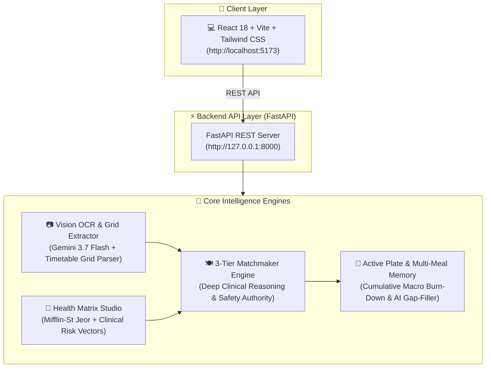

# 🥗 NutriMenu AI — Clinical 3-Tier Food Recommendation Engine

[](https://www.python.org/)
[](https://fastapi.tiangolo.com/)
[](https://react.dev/)
[](https://tailwindcss.com/)
[](https://aistudio.google.com/)
[](https://docs.pytest.org/)
[](LICENSE)

**NutriMenu AI** is an intelligent full-stack clinical recommendation platform that bridges physical restaurant menus with personalized metabolic and medical health matrices. Powered by **Google Gemini 3.7 Flash**, it digitizes complex restaurant and timetable menus, evaluates dishes against clinical guardrails, classifies them into **🟢 Tier 1: GOOD**, **🟡 Tier 2: MEDIUM**, and **🔴 Tier 3: BAD** tiers, and tracks active meal plates with multi-meal cumulative macro budgets.

---

## 🌟 Architecture & System Pipeline



---

## 🧭 Core Capabilities & Feature Suite

### 1. 📷 Multimodal Vision OCR & Timetable Grid Parser
- **Powered by Google Gemini 3.7 Flash**: High-accuracy vision recognition for restaurant menus, chalkboard specials, and university mess timetable grids.
- **Cell-by-Cell Grid Parsing**: Isolates meal slots and columns independently, preventing horizontal column text bleeding.
- **Dish Tokenization & Typo Fixing**: Splits compound lines (`Dosa, Sambhar, Chutney` $\to$ individual dishes) and autocorrects OCR typos (`Tdly` $\to$ `Idli`, `Pillka` $\to$ `Phulka`, `Rajama` $\to$ `Rajma`).
- **Multi-Layer Noise Filter**: Automatically strips template placeholders (`INSERT YOUR LOCATION HERE`), headers (`SRM UNIVERSITY`, `MENU`), timestamps (`7:30 AM - 9:15 AM`), and branding noise.

### 2. 👤 Clinical Health Matrix Studio
- **Biometric Inputs**: Age, Gender, Height, Weight, Activity Level, and Primary Goal (*Fat Loss*, *Muscle Gain*, *Maintenance*, *Healthy Aging*).
- **Clinical Condition Toggles**: Hypertension, Type 2 Diabetes, Pre-Diabetes, GERD, Hyperlipidemia, PCOS, Fatty Liver.
- **Zero-Tolerance Allergens**: Peanuts, Tree Nuts, Dairy, Gluten, Shellfish, Eggs, Soy, Sesame.
- **Live Synthesized Matrix**:
  - Mifflin-St Jeor daily caloric baseline with deficit/surplus adjustment.
  - Protein, Carbohydrate, and Fat target split bars.
  - Clinical Guardrails (Sodium ceiling, Glycemic sensitivity, Saturated fat limit, Minimum fiber).
  - Hard Exclusion Mask.

### 3. 🍽️ 3-Tier Food Recommendation Dashboard
- **Tier 1 🟢 (GOOD)**: High nutritional fit, optimal metabolic alignment, safe, health-promoting.
- **Tier 2 🟡 (MEDIUM)**: Moderate choice, acceptable with portion control or minor culinary modification.
- **Tier 3 🔴 (BAD)**: Strictly avoid, contains allergens/diet violations, high glycemic spikes, or excessive sodium/saturated fat.
- **Bespoke Dish-Level Clinical Reasoning**:
  - Detailed biochemical assessments referencing exact recipe ingredients.
  - Specific culinary green flags and red flags.
  - Actionable chef advice (e.g. *"Swap for Tandoori Paneer Tikka"*, *"Request unbuttered 100% whole wheat tandoori roti"*).
- **Deterministic Safety Authority**: Instant $0$-score override and Tier 🔴 assignment for declared allergens and ethical diets (e.g. meat on vegetarian protocols).

### 4. 🍱 Active Meal Plate & Daily Multi-Meal Memory
- **Interactive Plate Builder**: Add any recommended dish with custom portion multipliers (`0.5x`, `1.0x`, `1.5x`, `2.0x`, `3.0x`).
- **Cumulative Daily Macro Burn-Down**:
  - Two-tone progress bars tracking **Earlier Meals Logged Today** + **Current Active Plate** vs. Daily Targets.
  - Real-time remaining calorie, protein, carbohydrate, fat, and sodium safe budget calculations.
- **Multi-Meal History**: Log meals (Breakfast, Lunch, Snacks, Dinner) with timestamps and individual dish breakdowns preserved in browser storage (`localStorage`).
- **✨ Complete My Plate (AI Gap-Filler)**: Scans remaining menu items to suggest 1–2 complementary companion dishes balancing missing protein/fiber, with strict vegetarian and allergen exclusions.

### 5. 📅 Monthly Calendar & Historical Analytics
- **Interactive Calendar View**: Browse past meal intake by date and month to inspect daily nutritional compliance.
- **Nutritional Analytics & Daily Breakdowns**: Macro split charts comparing planned intake vs. clinical targets.
- **One-Click History Management**: Easily inspect logged dishes, modify portions, or clear historical logs.

### 6. 🔒 Enterprise Account Management & Production Security
- **Dual-Token Session Architecture**: Short-lived (15 min) JWT access tokens paired with rotating SHA-256 hashed refresh tokens (30 days).
- **Session Revocation & Reuse Detection**: Real-time server-side `auth_sessions` registry with family-based reuse detection that instantly terminates compromised token trees.
- **Active Devices & Remote Sign-Out**: Interactive sessions dashboard allowing users to inspect active browsers, IP addresses, and remotely revoke sessions.
- **Persistent Sliding-Window Rate Limiting**: Distributed database-backed rate limiting with reverse-proxy trust modeling (`TRUSTED_PROXY_COUNT`) and 10-attempt lockout defense.
- **Email Verification & Transactional SMTP**: Mandatory email confirmation flow with 6-digit cryptographic verification codes, attempt caps, and zero sensitive code disclosure.
- **Two-Factor Authentication (2FA/TOTP)**: RFC 6238 TOTP authenticator integration (Google Authenticator, Authy) and hashed backup codes.
- **GDPR & CCPA Data Privacy Suite**: Self-service full JSON personal data archiving and 14-day account deletion grace period with instant recovery.
- **Database Engine & Connection Pooling**: Production-grade PostgreSQL support via `psycopg3` with connection pooling (`pool_pre_ping=True`, `pool_size=10`, `max_overflow=20`), SSL enforcement, and Alembic migrations.

### 7. 📊 Multi-Format Export Studio
- 📊 **CSV Spreadsheet** (`.csv`) for Excel & Google Sheets
- 📝 **Markdown Report** (`.md`) for Obsidian, Notion & GitHub
- 🖨️ **Printable HTML / PDF** (`.html`) ready to print or save
- 💻 **Raw JSON Payload** (`.json`) for developer integration
- 📄 **Plain Text Summary** (`.txt`) for quick review

---

## ⚡ Quickstart & Installation

### 1. Clone & Install Dependencies

```bash
git clone https://github.com/CodeClosed/AI-Project.git
cd AI-Project

# Install Python backend dependencies
pip install -r requirements.txt

# Install React frontend dependencies
cd frontend
npm install
cd ..
```

---

### 2. Configure Gemini API Key

Create a `.env` file in the project root:
```env
# Google Gemini API Key (Primary Vision & Recommendation AI Engine)
# Get your API key from Google AI Studio: https://aistudio.google.com/app/apikey
GEMINI_API_KEY=your_gemini_api_key_here

# Model Selection (Default: gemini-3.7-flash)
GEMINI_MODEL=gemini-3.7-flash
```

*(You can also configure or change your API key directly inside the web UI via the Profile Drawer).*

---

### 3. Launch the Application
Runs both the FastAPI backend and React frontend concurrently:
```bash
python run_fullstack.py
```
- **React Frontend**: [http://localhost:5173](http://localhost:5173)
- **FastAPI Swagger Docs**: [http://127.0.0.1:8000/docs](http://127.0.0.1:8000/docs)

---

## 🧪 Automated Test Suite

All 113 unit and integration tests run 100% offline:

```bash
python -m pytest -v
```

### Complete Test Coverage (113/113 Tests):
| Test Module | Focus Area | Tests |
| :--- | :--- | :---: |
| `tests/test_security_and_auth.py` | CSRF protection, secure cookies, PBKDF2 hashing, rate limiting, IP tracking | 15 tests |
| `tests/test_extraction_validator.py` | Validation rules, confidence scoring, OCR schema compliance | 12 tests |
| `tests/test_mfa_and_password_reset.py` | TOTP MFA verification, secret encryption, password recovery flows | 11 tests |
| `tests/test_gemini_client.py` | Typed error handling, timeouts, 429 rate limits, candidate failover | 9 tests |
| `tests/test_safety_and_rules.py` | Strict allergen exclusions (score = 0), diabetic glycemic penalties | 7 tests |
| `tests/test_recommendation_engine.py` | 3-Tier classification, fuzzy OCR handling, batch matchmaker | 7 tests |
| `tests/test_noise_filter.py` | Multi-layer noise stripping, regex entropy, typo fixes | 6 tests |
| `tests/test_openrouter_extractor.py` | Vision extractor fallback pipeline | 6 tests |
| `tests/test_nutrition_ai.py` | Dish evaluator, macro splits, markdown serialization | 5 tests |
| `tests/test_recognizer.py` | Layout analysis, bounding box geometry, image stream support | 5 tests |
| `tests/test_auth_sessions.py` | Server-side sessions, rotating refresh tokens, reuse detection | 5 tests |
| `tests/test_production_config.py` | Production security invariants, secret validation assertions | 5 tests |
| `tests/test_plate_optimizer.py` | Multi-dish nutrient estimation, burn-down math, vegetarian safety | 4 tests |
| `tests/test_config.py` | Config getters, API key detection, fallback candidates | 4 tests |
| `tests/test_account_management.py` | Active session tracking, remote sign-out, GDPR data export | 4 tests |
| `tests/test_email_verification.py` | Cryptographic verification codes, expiration, resend cooldowns | 3 tests |
| `tests/test_matrix_generator.py` | Metabolic energy equations, macro distribution, clinical vectors | 3 tests |
| `tests/test_integration_pipeline.py` | End-to-end OCR $\to$ Matrix $\to$ 3-Tier Matchmaker | 2 tests |
| **Total Test Suite** | **Comprehensive Full-Stack Coverage** | **113 Tests** |

---

## 🛡️ Deterministic Safety Rules & Authority Hierarchy

To guarantee clinical safety, recommendations follow a strict two-stage hierarchy:

```
                      [ Evaluated Dish ]
                              │
               ┌──────────────┴──────────────┐
               ▼                             ▼
       [ Allergen Match? ]         [ Dietary Violation? ]
         (e.g., Peanuts)           (e.g., Meat on Vegetarian)
               │                             │
               └──────────────┬──────────────┘
                              ▼
                     [ Hard Conflict Detected? ]
                              │
                    ┌─────────┴─────────┐
                   YES                  NO
                    ▼                   ▼
           🔴 TIER 3: BAD      [ Calculate Continuous ]
          Fit Score = 0/100    [ Fit Score (0 - 100)  ]
        (Zero AI Override)              │
                                        ▼
                               🟢 GOOD / 🟡 MEDIUM / 🔴 BAD
```

1. **Deterministic Override**: If a dish contains declared allergens (e.g. peanuts, tree nuts, gluten) or violates explicit dietary choices (e.g. meat for a vegetarian, dairy for a vegan), it is **instantly forced to Tier 🔴 BAD (Fit Score = 0)**.
2. **Zero AI Override**: Generative AI models are never permitted to override hard safety constraints.

---

## 📡 REST API Documentation

The FastAPI backend exposes standard OpenAPI REST endpoints organized into key domains:

#### 🔐 Authentication & Session Security
- `POST /api/auth/register`: User account creation with Argon2/PBKDF2 password hashing.
- `POST /api/auth/login`: Issue short-lived access JWT + rotating SHA-256 refresh session.
- `POST /api/auth/refresh`: Single-use refresh token rotation with family reuse defense.
- `POST /api/auth/logout`: Revoke active session immediately.
- `GET /api/auth/me`: Retrieve authenticated user identity and permission role.
- `GET /api/auth/sessions`: List active devices, IP addresses, and session timestamps.
- `DELETE /api/auth/sessions/{session_id}`: Remotely revoke a specific session.
- `POST /api/auth/email/verify`: Verify email address with 6-digit cryptographic OTP.
- `POST /api/auth/password/reset`: Request or complete password reset flow.
- `POST /api/auth/mfa/setup` & `POST /api/auth/mfa/verify`: Configure and enable RFC 6238 TOTP 2FA.

#### 🥗 AI Nutrition & Menu Recognition
- `POST /api/ocr/extract`: Multipart image file upload. Runs Gemini 3.7 Flash vision extraction and grid parsing.
- `GET /api/jobs/{job_id}/events`: Server-Sent Events (SSE) streaming endpoint for live OCR progress.
- `POST /api/matrix/generate`: Accepts user biometrics and conditions; synthesizes metabolic targets and clinical risk vector matrix.
- `POST /api/recommend/evaluate`: Evaluates menu dishes against nutritional matrix; returns 3-tier classification and biochemical rationales.
- `POST /api/plate/evaluate`: Multi-dish plate evaluator computing cumulative macro burn-down against targets.
- `POST /api/plate/complete`: AI gap-filler proposing 1–2 companion dishes for missing protein/fiber.
- `GET /api/health`: Service health check, database status, and active AI model.

Interactive Swagger documentation is available at [http://127.0.0.1:8000/docs](http://127.0.0.1:8000/docs).

---

## 🚀 Deployment Guide

### 🐳 Backend Docker Containerization & Cloud Deployment (Render / Railway)

The backend provides a production-ready, slim Linux Docker image with CPU-only PyTorch and OpenCV image processing runtime:

#### Run with Docker Locally:
```bash
# Build the Docker image
docker build -t nutrimenu-backend .

# Run the container (binds to http://localhost:8000)
docker run -p 8000:8000 \
  -e GEMINI_API_KEY="your_gemini_api_key" \
  -e ALLOWED_ORIGINS="http://localhost:5173,https://codeclosed.github.io" \
  nutrimenu-backend
```

#### One-Click Cloud Blueprint (`render.yaml`):
The repository includes a ready-to-use Render Blueprint specification:
1. Connect your repository to [Render](https://render.com/).
2. Select **New** $\to$ **Blueprint** and pick `render.yaml`.
3. In the environment variables configuration, fill in your `GEMINI_API_KEY`.
4. Render automatically configures container builds, dynamic PORT binding (`${PORT:-8000}`), auto-generates secret keys, and attaches `/api/health` health checks.

---

### 🌐 Deploying the Frontend to GitHub Pages

The repository includes an automated GitHub Actions deployment workflow at `.github/workflows/deploy.yml`.

1. **Enable GitHub Pages**:
   - Go to your repository on GitHub: `Settings` $\to$ `Pages`.
   - Under **Build and deployment** $\to$ **Source**, choose **GitHub Actions**.
2. **Automated Continuous Deployment**:
   - Every push to `dev-vihaan` or `main` automatically triggers the GitHub Actions workflow.
   - Vite builds the production bundle with relative base paths (`base: './'`) and generates a `404.html` SPA fallback.
   - The React application is deployed to `https://codeclosed.github.io/AI-Project/`.
3. **Connecting Backend to GitHub Pages**:
   - In the deployed application, open **Settings** (top-right gear icon) $\to$ **Preferences** $\to$ **Backend API Endpoint**.
   - Input your backend API server URL (e.g. `https://your-backend-api.onrender.com` or local tunnel) and click **Save**.
   - You can also bake the endpoint into the build via the `VITE_API_BASE_URL` environment variable.

---

## 📁 Repository Structure

```
AI-Project/
├── .github/
│   └── workflows/
│       └── deploy.yml            # Automated GitHub Pages CI/CD workflow
├── .dockerignore                 # Docker build ignore patterns
├── Dockerfile                    # Multi-stage slim Docker image for FastAPI backend
├── render.yaml                   # Infrastructure-as-Code Blueprint for Render cloud
├── alembic/                      # Alembic schema versioning & database migrations
├── alembic.ini                   # Alembic configuration
├── backend/
│   ├── api.py                    # Hardened FastAPI REST server (CORS, CSRF, Audit)
│   ├── database.py               # PostgreSQL (psycopg3) connection pooling & SQLite fallback
│   ├── db_models.py              # Persistent relational models (Users, Sessions, Audit, RateLimits)
│   ├── email_service.py          # SMTPEmailBackend & transactional email templates
│   ├── maintenance.py            # Lifespan background worker for session & account purge
│   ├── settings.py               # Pydantic production invariant validation assertions
│   ├── auth/                     # Modular authentication and account management subsystem
│   │   ├── audit.py              # Cryptographic audit trail ledger
│   │   ├── codes.py              # HMAC 6-digit verification code manager
│   │   ├── deps.py               # Token verification & session revocation checks
│   │   ├── rate_limit.py         # Persistent sliding rate limiter & account lockout
│   │   ├── routes_account.py     # APIRouter for sessions, email change, activity, GDPR
│   │   └── sessions.py           # Rotating refresh tokens & family reuse detection
│   ├── jobs.py                   # Thread-safe async OCR & Recommendation job queue
│   ├── schemas.py                # Pydantic v2 validation contracts
│   └── security.py               # PBKDF2 hashing, JWT, TOTP 2FA, rate limiting
├── docs/
│   ├── PRODUCTION_CHECKLIST.md   # Complete production runbook & deployment guide
│   ├── SECURITY_AUDIT.md         # OWASP ASVS audit, threat model, and residual risk assessment
│   ├── ACCOUNT_SECURITY.md       # Bcrypt, JWT, TOTP MFA, and account lifecycle specifications
│   ├── DATA_RECOVERY.md          # Backup procedures, RPO/RTO objectives, and restore tests
│   ├── FEATURE_GAP_ANALYSIS.md   # Full feature verification matrix
│   ├── SECURITY_REMEDIATION_LOG.md # Detailed remediation log of all fixed vulnerabilities
│   ├── SECURITY_TEST_PLAN.md     # Multi-tenant IDOR test plan and execution commands
│   ├── menu_recognition_module.md # Multimodal Vision OCR and layout analysis specification
│   ├── nutrition_recommendation_module.md # Clinical nutritional scoring specification
│   ├── tiered_recommendation_module.md # 3-Tier Good/Medium/Bad matchmaking specification
│   └── user_matrix_module.md     # Mifflin-St Jeor metabolic matrix specification
├── frontend/
│   ├── src/
│   │   ├── components/
│   │   │   ├── account/          # Account management UI panels (Sessions, Activity, GDPR)
│   │   │   ├── Layout.jsx
│   │   │   ├── SettingsModal.jsx # Multi-tab preferences & security center
│   │   │   └── ...
│   │   ├── context/              # Context providers (AuthContext, NutritionContext, ThemeContext)
│   │   ├── pages/                # Multi-page views (Dashboard, Menu, Plate, VerifyEmail, Profile)
│   │   ├── utils/                # Data export utilities (CSV / JSON)
│   │   ├── App.jsx               # Main React router (HashRouter for GitHub Pages)
│   │   ├── api.js                # API client with JWT injection & single-flight token rotation
│   │   └── index.css             # Tailwind CSS & design tokens
│   ├── package.json
│   └── vite.config.js            # Vite build configuration with copy-404 plugin
├── src/
│   ├── gemini_client.py          # Google Gemini API Client
│   ├── gemini_extractor.py       # Multimodal table grid OCR menu extractor
│   ├── plate_optimizer.py        # Multi-dish plate synergy & companion suggester
│   ├── matrix_generator.py       # Mifflin-St Jeor metabolic & clinical matrix
│   ├── recommendation_engine.py  # 3-tier classification & safety rule authority
│   ├── noise_filter.py           # Multi-layer OCR noise filter & typo correction
│   ├── pipeline.py               # End-to-end menu recognition pipeline
│   ├── models.py                 # Data classes & schemas
│   └── config.py                 # Centralized configuration & thresholds
├── tests/                        # 100% offline pytest test suites (113 tests passing)
│   ├── test_account_management.py     # Active sessions, email changes & GDPR export tests
│   ├── test_auth_sessions.py          # Token rotation & reuse detection tests
│   ├── test_email_verification.py     # Email verification OTP flow tests
│   ├── test_production_config.py      # Production invariant validator tests
│   ├── test_security_and_auth.py      # Auth, brute-force & CSRF security test suite
│   ├── test_mfa_and_password_reset.py # MFA & password reset test suite
│   └── ...
├── run_fullstack.py              # Full-stack launcher (FastAPI + React)
└── requirements.txt              # Python dependencies
```

---

## ℹ️ Medical & Nutritional Guidance Disclaimer

**Notice**: Recommendations provided by NutriMenu AI are personalized computational estimates based on user-entered parameters, Mifflin-St Jeor metabolic equations, and published clinical nutritional literature. This application is not a medical device and does not substitute for personalized medical diagnoses, treatments, or dietary prescriptions from a licensed physician or registered dietitian.

