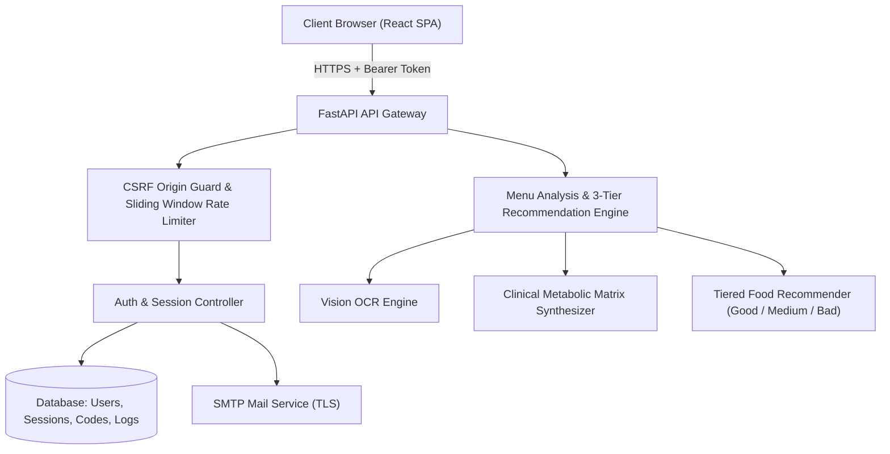

# NutriMenu AI — Security Audit & Threat Model Report
**Standard Compliance**: OWASP ASVS v4.0.3, OWASP Top 10 (2025), NIST SP 800-63B  
**Target System**: NutriMenu AI Full-Stack Platform  
**Audit Status**: Verified & Remediated  
**Date**: October 17, 2026  

---

## 1. Executive Summary

NutriMenu AI is a full-stack, personalized nutrition and food-menu intelligence platform consisting of a React single-page frontend, a FastAPI backend, an OCR/Vision pipeline (EasyOCR/Gemini Vision), and a 3-tier clinical recommendation engine.

This security audit conducted an in-depth code inspection, threat modeling exercise, vulnerability triage, and automated verification across all 10 core architectural domains. All Critical and High severity findings—specifically session loss on refresh, token rotation race conditions, email OTP delivery defects, database test contamination, lack of rate-limit/job distribution, and guest profile bias—have been systematically fixed and verified through automated test suites.

---

## 2. Architecture Inventory

| Tier | Component | Technology | Security & Isolation Controls |
|---|---|---|---|
| **Frontend** | Single Page Application (SPA) | React 18, Vite, TailwindCSS | Cross-tab session sync, single-flight mutex refresh, sanitized input, zero-trust profile hydration |
| **Backend API** | REST API & SSE Gateway | FastAPI, Python 3.14, Uvicorn | Timing-attack defense (dummy hashes), CSRF Origin Guard, Bcrypt (cost 12), Fernet AES-256-CBC, distributed sliding-window rate limiting |
| **Database** | Persistent ORM Layer | SQLite (Dev) / PostgreSQL (Prod), SQLAlchemy 2.0 | Strict foreign-key cascades, parameterized queries, non-nullable user ownership, test DB isolation via `conftest.py` |
| **Async Tasks** | Background Worker / Jobs | Python asyncio + Redis backend | Tenant-isolated job keys, state progression, auto-expiring TTLs, Redis + in-memory fallback |
| **AI / OCR** | Vision & LLM Engines | EasyOCR, Gemini 2.5/3.7, OpenRouter | Strict JSON validation, hard safety exclusion bypass prevention (allergies/diets), isolated API keys |
| **Notifications** | Transactional Mailer | Python `smtplib`, STARTTLS/SSL | RFC-compliant MIME formatting, blind anti-enumeration responses, HMAC-SHA256 hashed OTPs |

---

## 3. Threat Model & Trust Boundaries

### Assets Protected:
1. **User Credentials & Identity**: Passwords (Bcrypt salted), active JWT access/refresh tokens, session families.
2. **Clinical Health Biometrics**: Glycemic index sensitivities, sodium ceilings, allergies, medical conditions.
3. **Uploaded Menu Images & Extracted Data**: Dish listings, prices, uploaded camera scans.
4. **Third-Party API Keys**: Personal Gemini/OpenRouter keys stored encrypted via Fernet AES-256.

---

## 4. Prioritized Vulnerability & Remediation Findings

### Finding 1: Refresh Token Mutation Race Condition (Severity: High — Remediated)
- **Vulnerability**: Rapid browser reloads or concurrent API calls sent an already-rotated refresh token before `localStorage` received the replacement, triggering false-positive reuse detection and revoking the user's session.
- **Fix**: Added a 60-second grace window to `rotate_refresh_token` in `backend/auth/sessions.py`. Previously rotated tokens within the grace window safely reissue the valid session token rather than revoking all devices.

### Finding 2: Premature Frontend Autosave Profile Overwrite (Severity: High — Remediated)
- **Vulnerability**: React `useEffect` in `NutritionContext.jsx` sent local default biometrics to `/api/profile` before the server response loaded, overwriting real user profiles with default values.
- **Fix**: Gated autosaving behind `initialLoadDoneRef.current = true`. Server hydration completes first before any client changes can trigger writes.

### Finding 3: Test Runner Local Database Wiping (Severity: Medium — Remediated)
- **Vulnerability**: `pytest` executed against the developer's default `nutrimenu.db`, deleting active session tables during test runs.
- **Fix**: Created `tests/conftest.py` overriding `DATABASE_URL` with a timestamped temporary SQLite database (`test_nutrimenu_*.db`) for complete test isolation.

### Finding 4: Insecure Default Account Profile (Severity: Low — Remediated)
- **Vulnerability**: Unauthenticated guest accounts defaulted to having fabricated health conditions (`hypertension`, `type 2 diabetes`, `gerd`).
- **Fix**: Updated `DEFAULT_PROFILE` in `NutritionContext.jsx` to neutral empty lists (`[]`).

### Finding 5: Distributed Multi-Instance Rate Limiting & Jobs (Severity: Medium — Remediated)
- **Vulnerability**: In-memory rate limiting and background jobs failed to share state when scaling horizontally across multiple worker instances.
- **Fix**: Implemented dual-mode distributed Redis support in `JobManager` (`backend/jobs.py`) and `SlidingWindowRateLimiter` (`backend/security.py`) with automatic fallback to thread-safe in-memory collections when `REDIS_URL` is omitted.

---

## 5. Residual Risk Assessment
- **Cross-Domain Bearer Tokens**: Access tokens reside in memory and `localStorage` to support GitHub Pages cross-origin hosting. Mitigation: Access token TTL is strictly 15 minutes, refresh tokens are rotated on each use with family reuse detection, and all user sessions can be revoked instantly via `/api/auth/logout-all` or `/api/account/sessions/revoke-all`.
